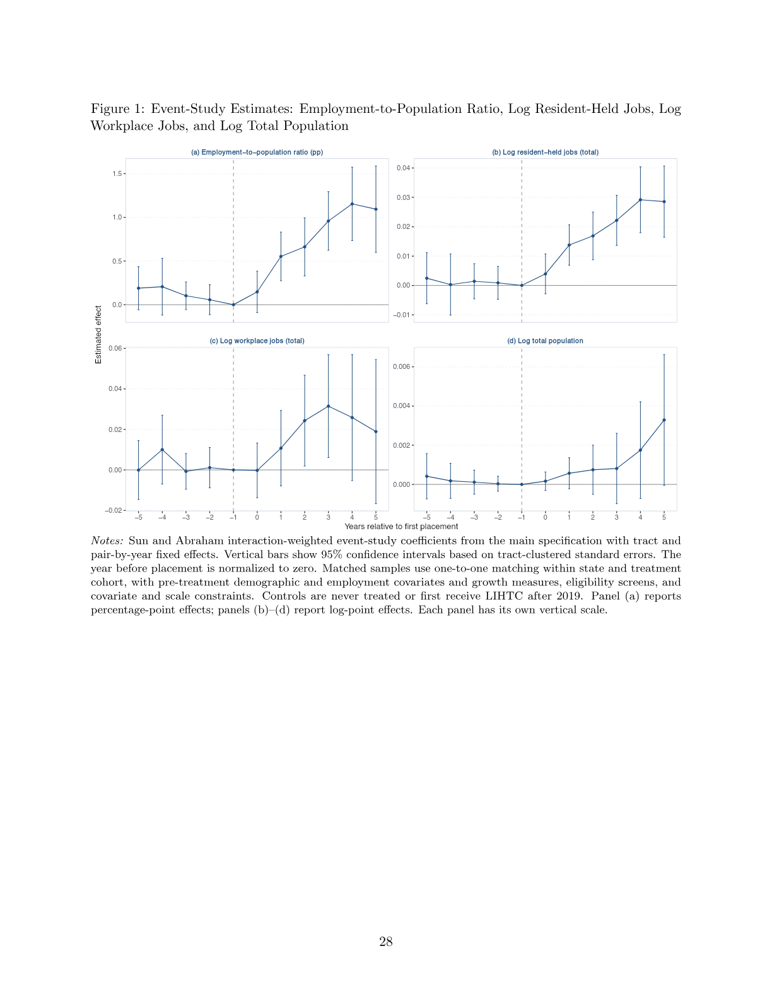
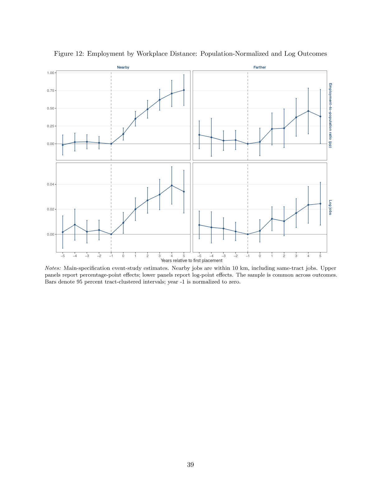

# Affordable Housing and Neighborhood Employment

**Sijia Chen · Job market paper**

## Project overview

How does affordable housing construction change employment in the neighborhoods that receive it? This paper studies the Low-Income Housing Tax Credit (LIHTC) program and distinguishes **jobs held by neighborhood residents** from **jobs located in the neighborhood**. This distinction captures employment gains even when residents work outside their home tract.

I link federal LIHTC project records, LODES administrative employment and residence–workplace flows, and population data for 2010–2019. The design combines propensity score matching within state and treatment cohort with a staggered event study, including tract and matched-pair-by-year fixed effects.

## Main findings

- Following LIHTC development, resident-held jobs rise by approximately **2%** relative to matched untreated tracts. Jobs per resident rise by **0.80 percentage points**, with little estimated net population growth.
- Gains occur at both nearby and more distant workplaces. Nearby jobs account for the larger share of the increase in jobs per resident, and average commuting distance declines by approximately **1.3 km**.
- Employment gains are positive in both lower- and higher-income neighborhoods, with larger point estimates in higher-income neighborhoods despite broadly comparable housing additions.
- Cumulative resident-held employment increases within **3 km and 5 km**, suggesting that relocation from immediate neighbors alone does not explain the host-tract gain.

These are neighborhood-level effects; the data do not separate incumbent residents' employment changes from changes in who lives in the neighborhood.

## Key figures

### Main event-study results



The figure contrasts residence-side employment gains with workplace employment and population responses. The ratio in panel (a) counts jobs held by residents divided by total population; it is not the conventional working-age employment rate. Source: paper Figure 1, p. 28.

### Where do residents work?



Nearby jobs are within 10 km using straight-line tract-centroid distances, including same-tract jobs; distant jobs are beyond that threshold. The upper panels show contributions to jobs per resident, while the lower panels show log job counts. This distance split differs from the road-network distance used in the commuting analysis. Source: paper Figure 12, p. 39.

## Code and reproducibility

The [code guide](docs/CODE_GUIDE.md) describes the Python workflow for unique residence–workplace pairs, batched OSRM routing, and employment-weighted commuting panels. The selected scripts showcase the commuting-data pipeline; they do not reproduce the paper's event-study figures.

```sh
pip install -r requirements.txt
python code/check_synthetic_panel.py
```

[Validation](docs/VALIDATION.md) · [Sources and code provenance](docs/SOURCES.md)
